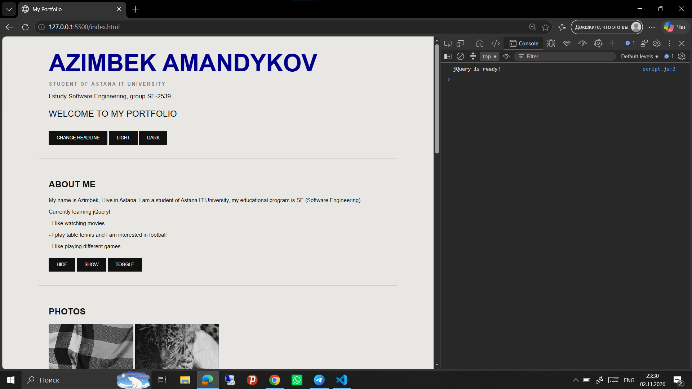
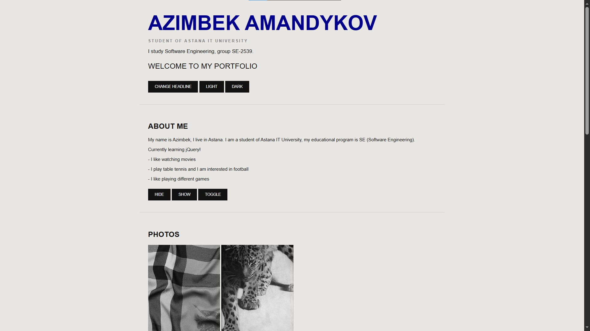
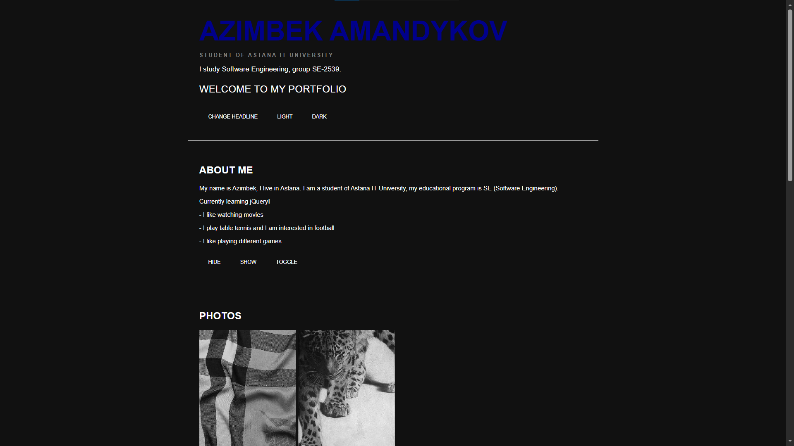
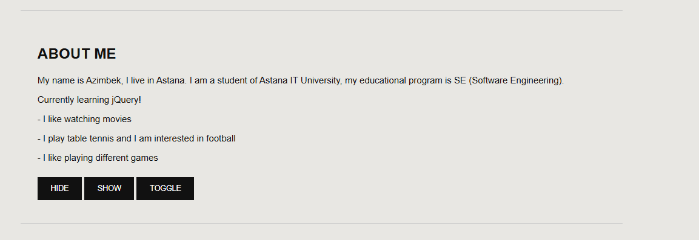
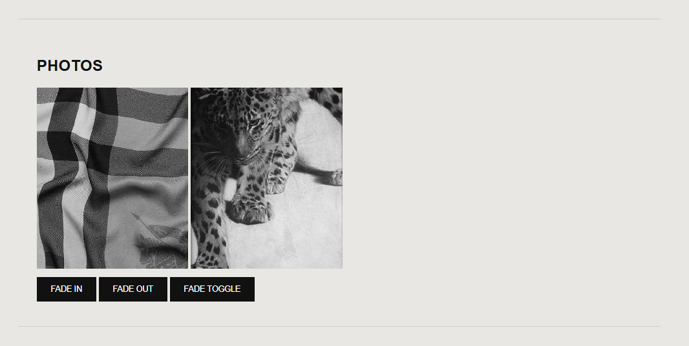
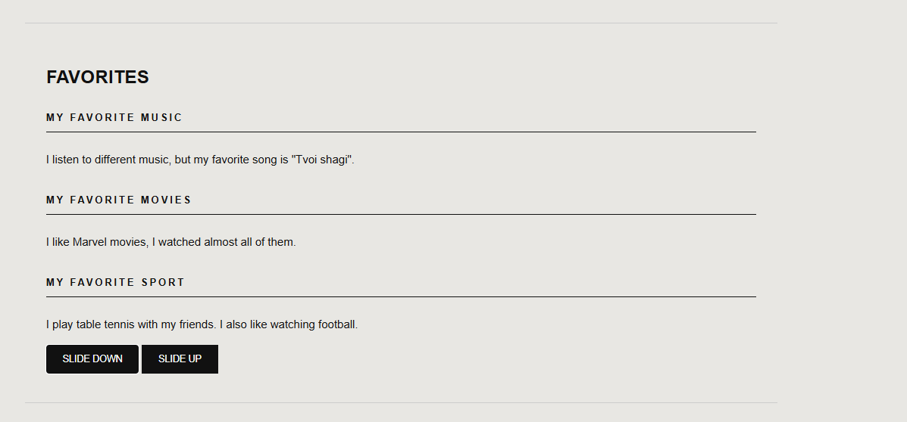
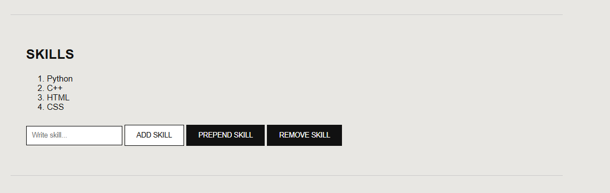
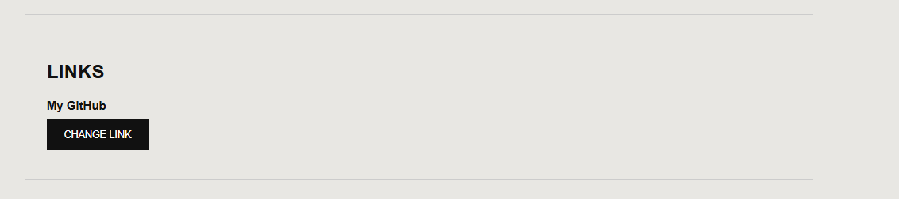
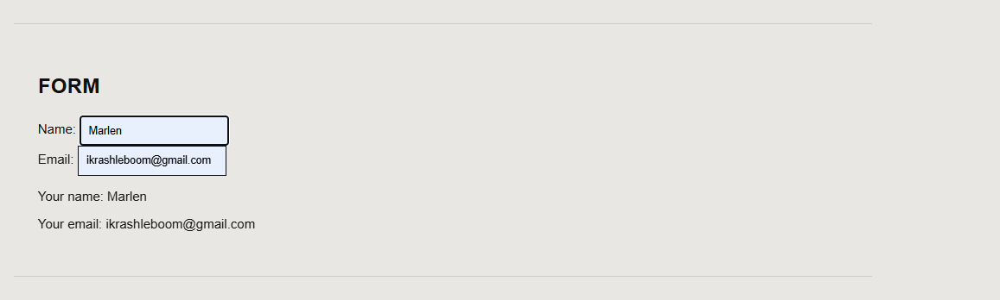
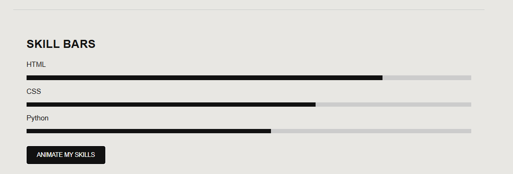

# Assignment #6. jQuery (Selectors, Effects, Animations)

**Name:** Amandykov Azimbek
**Group:** SE-2539

**GitHub Pages:** https://ikrashleboom-svg.github.io/assignment6-web/

---

## Part 1. Getting Started with jQuery

### Task 0. Setup
jQuery is included from CDN, `$(document).ready()` is used, and "jQuery is ready!" is printed in the console.

### Task 1. Selectors & CSS
Name, headline, introduction and "Welcome to My Portfolio" section. Tag, ID and class selectors are used. The headline and greeting are changed with `.text()` and `.html()`, styles are changed with `.css()`. Buttons switch between light and dark themes.

## Part 2. jQuery Effects

### Task 2. Visibility Methods
"About Me" section with biography, status message and fun facts. Hide, Show and Toggle buttons control visibility.

### Task 3. Fade Methods
Gallery with three images. `.fadeIn()`, `.fadeOut()` and `.fadeToggle()` control the images.

### Task 4. Slide Methods
Three clickable headings (Music, Movies, Sport) with collapsible panels using `.slideToggle()`, `.slideDown()` and `.slideUp()`.

## Part 3. DOM Manipulation with jQuery

### Task 5. Add & Remove Elements
List of skills, input field and buttons "Add Skill" (`.append()`), "Prepend Skill" (`.prepend()`), "Remove Skill" (`.remove()`). Empty skills cannot be added.

### Task 6. Modifying Attributes
Social link whose `href` is changed with `.attr()` when the button is clicked.

### Task 7. Form Interaction
Form with Name and Email. Input is shown live below the form using `.val()` and `.text()`.

## Part 4. Animations

### Task 8. Basic Animation
Skill bars start at zero width. "Animate My Skills" button uses `.animate()` to grow them to different widths (HTML 80%, CSS 65%, Python 55%). A second click animates them back to zero.

---

## Summary of Work Process
First, I created the HTML structure of the portfolio with a section for each task and added basic styles in CSS. Then I connected jQuery from a CDN and wrote all the logic inside `$(document).ready()`. I used selectors and `.css()`, `.text()`, `.html()` for the first part, then added effects (show/hide, fade, slide), DOM manipulation (`.append()`, `.prepend()`, `.remove()`, `.attr()`, `.val()`), and finally skill bar animation with `.animate()`. After testing everything in the browser, I took screenshots, uploaded the project to GitHub and published it with GitHub Pages.
